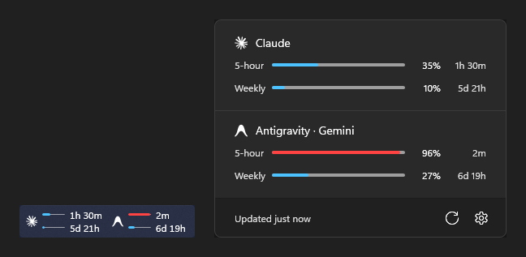

# LimitBar

[English](README.md) · **한국어**

Claude, GPT(Codex), Cursor, GitHub Copilot, Antigravity, OpenCode Go의 사용 한도를 윈도우 11 작업 표시줄에 보여주는 작은 위젯입니다.



- **작업 표시줄 칩**: 서비스마다 로고, 바 두 줄(위 5시간 / 아래 주간), 초기화까지 남은 시간
  - 시간 표기: `1d 1h` → 하루 안쪽 `5h 12m` → 한 시간 안쪽 `47m` (끝자리가 0이면 생략: `30d`)
  - 사용량 0%인 롤링 한도는 초기화 타이머가 돌지 않으므로 한도 길이를 흐리게 표시. 결제 주기처럼 날짜가 정해진 한도는 0%여도 남은 시간을 표시
- **패널**: 칩을 누르면 빠른 설정처럼 작업 표시줄에서 올라옵니다
- **설정** (톱니): 표시할 서비스, Antigravity 한도 그룹(Gemini / Claude + GPT), 새로고침 간격(1·5·15분), 언어, Windows 시작 시 실행. `%APPDATA%\LimitBar\settings.json`에 저장됩니다
  - 처음 실행할 때는 이 PC에 CLI나 로그인이 있는 서비스만 켜지고, 나머지는 설정에서 켤 수 있습니다
- **색**: 70% 미만 파랑, 70–89% 노랑, 90% 이상 빨강 (윈도우 11 진행 바의 일반 / 일시 정지 / 오류 색)
- 윈도우 다크/라이트 테마를 따르고, 작업 표시줄과 같은 글꼴을 씁니다
- 토글, 서랍, 콤보박스, 열기·닫기 애니메이션은 윈도우 11 컨트롤(WinUI)의 시간·곡선 값을 그대로 씁니다
- 항상 켜 두는 프로그램이라 가볍게 동작합니다: GPU를 쓰지 않고(소프트웨어 렌더링), 보이는 내용이 바뀔 때만 다시 그리며, 화면이 잠겨 있으면 조회하지 않습니다. 대기 중 메모리는 10–20 MB 정도입니다

## 다운로드

[Releases](https://github.com/jjoni12/LimitBar/releases)에서 `LimitBar.zip`을 받아 아무 폴더에 풀고 `LimitBar.exe`를 실행하면 됩니다. 코드 서명이 없는 exe라 처음 실행할 때 Windows SmartScreen 경고가 뜰 수 있습니다("추가 정보" → "실행"). 계속 켜 두려면 설정에서 **Windows 시작 시 실행**을 켜세요.

## 필요한 것

- Windows 11. 윈도우에 기본으로 들어 있는 .NET Framework 4.8로 돌아가서 따로 설치할 게 없습니다. (Windows 10은 테스트하지 않았습니다.)
- 보고 싶은 서비스의 CLI나 앱에 로그인돼 있어야 합니다.
  - Claude: [Claude Code](https://code.claude.com) (`claude`)
  - GPT: [Codex CLI](https://github.com/openai/codex) (`codex`)
  - Cursor: Cursor 앱
  - Copilot: [GitHub CLI](https://cli.github.com) (`gh auth login`)
  - Antigravity: Antigravity CLI (`agy`) 1.1.11 이상
  - OpenCode Go: [OpenCode](https://opencode.ai)에서 OpenCode 콘솔 로그인 또는 Go API 키 등록 (또는 환경 변수 `OPENCODE_API_KEY`)

## 데이터를 가져오는 방식

위젯에서 따로 로그인하지 않고, 각 도구가 이미 저장해 둔 로그인을 읽기만 합니다. 토큰은 그 서비스의 자기 서버로만 보내고, 저장하거나 로그에 남기지 않습니다.

| 서비스 | 방식 |
|---|---|
| Claude | `~/.claude/.credentials.json`의 토큰으로 `api.anthropic.com/api/oauth/usage` 조회 (Claude Code `/usage` 화면과 같은 데이터). 토큰이 만료되면 `claude auth status`를 실행해 Claude Code가 직접 갱신하게 합니다. |
| GPT | `~/.codex/auth.json`의 토큰으로 `chatgpt.com/backend-api/wham/usage` 조회 (Codex CLI 소스에 있는 주소). 한도 길이는 서버 값을 따라가서 무료 플랜은 30일 한 줄로 나옵니다. |
| Cursor | Cursor가 저장한 로그인(`%APPDATA%\Cursor\User\globalStorage\state.vscdb`)을 윈도우에 들어 있는 SQLite(`winsqlite3.dll`)로 읽기 전용으로 열어, cursor.com 대시보드와 같은 `cursor.com/api/usage-summary`를 조회합니다. 결제 주기 한 줄. |
| Copilot | `gh api /copilot_internal/user` (Copilot 편집기 확장이 쓰는 주소). 요청은 GitHub CLI가 자기 로그인으로 보내서 위젯은 GitHub 토큰을 다루지 않습니다. 월간 한도: 유료 플랜은 프리미엄 요청, 무료 플랜은 채팅과 자동완성. |
| Antigravity | 공식 명령 `agy -p /usage --output-format json`. 설정에서 고른 그룹(기본 Gemini)을 표시합니다. |
| OpenCode Go | OpenCode 자체 클라이언트(`packages/core/src/usage-limits.ts`)와 같은 방식으로 `opencode.ai/zen/go/v1/usage` 조회. OpenCode 2는 `~/.local/share/opencode/opencode.db`의 콘솔 로그인(워크스페이스를 `x-opencode-org-id`로 보냄) 또는 Go 키를, OpenCode 1은 `auth.json`을 읽습니다. 5시간 / 주간 / 월간 한도 (칩에는 앞의 두 개). |

Antigravity를 뺀 나머지 주소는 공개 문서에 없는 것이라 예고 없이 바뀔 수 있습니다. 막히면 그 서비스만 오류 문구가 나오고 나머지는 그대로 동작합니다. 새로고침 간격은 설정값(기본 5분)이고, 실패하면 15분 뒤에 다시 시도합니다. 한 서비스에 30초 안에 두 번 묻지는 않습니다. 서버가 "요청이 너무 많다"(429)고 하면 잠깐(서버가 알려 준 시간, 최대 30초) 기다렸다가 한 번 더 묻고, 그래도 안 되면 문구를 띄우고(받아 둔 숫자가 있으면 그 아래에) 통할 때까지 5초마다 다시 시도합니다. 오류 기록은 `%LOCALAPPDATA%\LimitBar\log.txt`에 남습니다.

## 언어

기본 제공: English, 한국어, 日本語, 简体中文, 繁體中文, Español, Português (Brasil), Deutsch, Français, Русский. 윈도우 표시 언어를 따라가고(번역이 없는 언어면 영어), **설정 → 언어**에서 바꿀 수 있습니다.

### 언어팩 추가하기

1. [`src/LimitBar/Assets/lang/en.json`](src/LimitBar/Assets/lang/en.json)을 복사해서 값을 번역합니다. `LanguageName`에는 그 언어로 쓴 언어 이름을 넣습니다 (목록에 이 이름이 나옵니다).
2. `%APPDATA%\LimitBar\lang\<코드>.json`으로 저장합니다. `<코드>`는 `it`, `pt-PT` 같은 언어 태그입니다.
3. 패널을 다시 열면 **설정 → 언어**에 나타납니다.

빠진 항목은 영어로 나옵니다. 기본 언어와 같은 코드로 만들면 그 파일에 있는 문구만 바꿔 씁니다. LimitBar에 기본으로 넣고 싶다면 `src/LimitBar/Assets/lang/`에 파일을 추가해서 풀 리퀘스트를 보내 주세요.

## 서비스 추가하기

### 코드 없이: `services.json`

`%APPDATA%\LimitBar\services.json`에 서비스를 적고 LimitBar를 다시 실행하면 칩, 패널, 설정의 "표시할 서비스"에 나타납니다.

```json
[
  {
    "id": "my-service",
    "name": "My Service",
    "command": "powershell.exe",
    "arguments": "-NoProfile -ExecutionPolicy Bypass -File \"%USERPROFILE%\\LimitBar\\my-service.ps1\"",
    "timeoutSeconds": 30
  }
]
```

- `id`: 영문 소문자 식별자. 기본 서비스(`claude`, `gpt`, `cursor`, `copilot`, `antigravity`, `opencode`)와 겹치면 무시됩니다.
- `command`, `arguments`: 실행할 프로그램과 인자. `%USERPROFILE%` 같은 환경 변수를 쓸 수 있습니다.

명령은 표준 출력으로 아래 형식의 JSON을 내보내면 됩니다. 짧은 한도부터 두 개가 칩의 위·아래 줄에 나옵니다.

```json
{
  "windows": [
    { "lengthSeconds": 18000,  "usedPercent": 42, "resetsAt": "2026-11-01T12:00:00Z" },
    { "lengthSeconds": 604800, "usedPercent": 12, "resetsAt": 1793534400 }
  ]
}
```

- `lengthSeconds`: 한도 기간(초). 5시간 = 18000, 1주 = 604800
- `usedPercent`: 사용률 0–100
- `resetsAt`: 초기화 시각. ISO-8601 문자열이나 Unix 초
- 실패를 알리려면 `{ "error": "로그인이 필요해요" }`처럼 내보내면 그 문구가 표시됩니다.

로고는 `%APPDATA%\LimitBar\logos\<id>.svg`에 단색 SVG로 두면 됩니다. 없으면 이름 첫 글자가 나옵니다. 동작하는 예제는 [`examples/`](examples/)에 있습니다.

### 코드로: 기본 서비스 추가

1. `src/LimitBar/Providers/`에 `IUsageProvider`를 구현합니다 (`ClaudeProvider.cs`가 짧은 예시). `IsSetUp`은 이 PC에 그 서비스의 CLI나 로그인이 있는지로, 처음 실행할 때 켜 둘지만 정합니다.
2. 단색 로고를 `src/LimitBar/Assets/logos/<id>.svg`에 둡니다 (빌드 때 exe에 포함됩니다).
3. `Providers/ProviderRegistry.cs`의 목록에 한 줄 추가합니다. 목록 순서가 설정과 칩의 표시 순서입니다.

## 빌드

[.NET SDK](https://dotnet.microsoft.com/download)가 필요합니다.

```
dotnet build src/LimitBar -c Release
```

결과물: `src/LimitBar/bin/Release/net48/LimitBar.exe`

## 로고 바꾸기

`%APPDATA%\LimitBar\logos\` 또는 exe 옆 `logos\` 폴더에 `<id>.svg`(예: `claude.svg`)를 넣으면 기본 로고 대신 씁니다. 단색 SVG면 되고, 작업 표시줄 글자색으로 칠해집니다.

## 작업 표시줄에 붙는 방식

윈도우 11에는 작업 표시줄에 직접 무언가를 넣는 공식 API가 없습니다. 작업 표시줄 위에 뜨는 별도 창은 시작 메뉴, 달력, 빠른 설정이 열릴 때마다 셸이 작업 표시줄을 위로 끌어올려서 가려지거나 깜빡입니다. 그래서 칩은 작업 표시줄 창(`Shell_TrayWnd`)의 자식 창으로 붙습니다. 덕분에 작업 표시줄과 함께 움직이고 같이 숨으며(자동 숨김, 전체 화면), 셸 창이 열려도 계속 보입니다. 다만 공식으로 지원하는 방식은 아니라서 윈도우 큰 업데이트 때 동작이 달라질 수 있습니다. 탐색기가 다시 시작되면 1초 안에 다시 붙습니다.

## 상표

Claude는 Anthropic, Antigravity와 Gemini는 Google, GPT와 Codex는 OpenAI, GitHub Copilot은 GitHub, Cursor는 Anysphere의 상표이고, OpenCode는 OpenCode 프로젝트 소유자의 상표입니다. 기본 로고는 [LobeHub Icons](https://github.com/lobehub/lobe-icons)(MIT)의 단색 SVG이며 서비스 식별용으로만 씁니다. 이 프로젝트는 위 회사들과 관계가 없습니다.

## 라이선스

[MIT](LICENSE)
