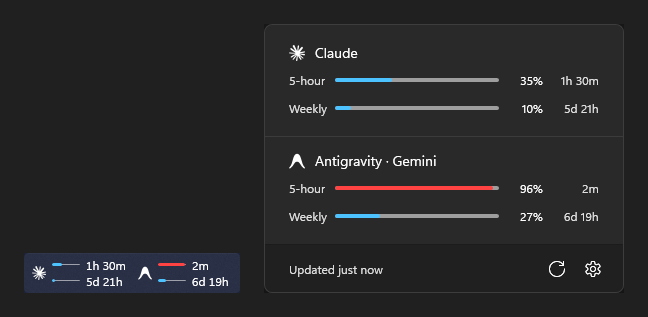

# LimitBar

**English** · [한국어](README.ko.md)

A small Windows 11 taskbar widget that shows how much of your AI coding tool limits you've used: Claude, GPT (Codex), Cursor, GitHub Copilot, Antigravity and OpenCode Go.



- **Taskbar chip**: per service, a logo, two bars (top: 5-hour limit, bottom: weekly) and the time until each resets
  - Time reads `1d 1h`, then `5h 12m` within a day, then `47m` within an hour (a zero last unit is dropped: `30d`)
  - A rolling limit at 0% has no running reset clock, so it shows its length, dimmed. Limits that reset on a set date (a billing month) count down even at 0%
- **Panel**: click the chip and it rises out of the taskbar like Quick Settings
- **Settings** (the gear): services to show, Antigravity limit group (Gemini / Claude + GPT), refresh interval (1, 5 or 15 min), language, start with Windows. Saved in `%APPDATA%\LimitBar\settings.json`
  - On first run, only services this PC is set up for are shown; the rest can be turned on in settings
- **Colors**: blue under 70%, yellow 70–89%, red from 90% (Windows 11's normal / paused / error progress colors)
- Follows the Windows dark/light theme and uses the taskbar's own font
- Toggles, drawers, combo boxes and the open/close motion use the timings and curves of the Windows 11 controls (WinUI)
- Light enough to leave running: no GPU (software rendering), redraws only when what you see changes, and doesn't fetch while the screen is locked. About 10–20 MB of memory when idle

## Download

Get `LimitBar.zip` from [Releases](https://github.com/jjoni12/LimitBar/releases), unzip it anywhere and run `LimitBar.exe`. The exe isn't code-signed, so Windows SmartScreen may warn the first time ("More info" → "Run anyway"). Turn on **Start with Windows** in settings to keep it running.

## Requirements

- Windows 11. It runs on .NET Framework 4.8, which ships with Windows, so there's nothing to install. (Windows 10 isn't tested.)
- Be signed in to the CLI or app of each service you want to see:
  - Claude: [Claude Code](https://code.claude.com) (`claude`)
  - GPT: [Codex CLI](https://github.com/openai/codex) (`codex`)
  - Cursor: the Cursor app
  - Copilot: [GitHub CLI](https://cli.github.com) (`gh auth login`)
  - Antigravity: Antigravity CLI (`agy`) 1.1.11 or later
  - OpenCode Go: [OpenCode](https://opencode.ai), signed in to the OpenCode Console or with a Go API key added (or the `OPENCODE_API_KEY` environment variable)

## How it gets the numbers

LimitBar never signs in by itself. It only reads the sign-in each tool already saved, sends that token only to the service's own server, and never stores or logs it.

| Service | How |
|---|---|
| Claude | Token from `~/.claude/.credentials.json`, then `api.anthropic.com/api/oauth/usage` (the data behind Claude Code's `/usage`). When the token is stale it runs `claude auth status` so Claude Code refreshes its own sign-in. |
| GPT | Token from `~/.codex/auth.json`, then `chatgpt.com/backend-api/wham/usage` (the address in the Codex CLI source). Window lengths come from the server, so the free plan shows a single 30-day row. |
| Cursor | Cursor's saved sign-in (`%APPDATA%\Cursor\User\globalStorage\state.vscdb`), opened read-only with the SQLite built into Windows (`winsqlite3.dll`), then `cursor.com/api/usage-summary`, as the cursor.com dashboard does. One row: the billing month. |
| Copilot | `gh api /copilot_internal/user` (what Copilot's editor extensions use). The GitHub CLI signs the request, so LimitBar never handles the GitHub token. Monthly: premium requests on paid plans, chat and completions on Copilot Free. |
| Antigravity | The official `agy -p /usage --output-format json`, showing the group picked in settings (Gemini by default). |
| OpenCode Go | `opencode.ai/zen/go/v1/usage`, asked the same way OpenCode's own client does (`packages/core/src/usage-limits.ts`), with the sign-in OpenCode saved: in OpenCode 2, a Console sign-in (workspace sent as `x-opencode-org-id`) or a Go key in `~/.local/share/opencode/opencode.db`; in OpenCode 1, `auth.json`. 5-hour, weekly and monthly limits (the chip shows the first two). |

Except for Antigravity, these addresses aren't publicly documented and may change without notice. If one stops working, only that service shows an error; the rest keep working. Data refreshes at the interval set in settings (5 min by default), and after a failure it tries again in 15 minutes. One service is never asked twice within 30 seconds. On "too many requests" (429) it waits briefly (as long as the server asks, up to 30 s) and asks once more; if that fails too it shows a note (under the last numbers, if any) and tries every 5 seconds until it gets through. Errors are logged to `%LOCALAPPDATA%\LimitBar\log.txt`.

## Languages

Built in: English, 한국어, 日本語, 简体中文, 繁體中文, Español, Português (Brasil), Deutsch, Français, Русский. LimitBar follows the Windows display language (English if it has no translation for it); pick another under **Settings → Language**.

### Adding a language pack

1. Copy [`src/LimitBar/Assets/lang/en.json`](src/LimitBar/Assets/lang/en.json) and translate the values. Set `LanguageName` to the language's own name (it's what the list shows).
2. Save it as `%APPDATA%\LimitBar\lang\<code>.json`, where `<code>` is the language tag, such as `it` or `pt-PT`.
3. Reopen the panel: the language appears under **Settings → Language**.

Missing keys fall back to English. A file with the same code as a built-in language overrides just the strings it contains. To ship a language with LimitBar, add the file to `src/LimitBar/Assets/lang/` in a pull request.

## Adding a service

### Without code: `services.json`

List the service in `%APPDATA%\LimitBar\services.json` and restart LimitBar; it shows up in the chip, the panel and the settings list.

```json
[
  {
    "id": "my-service",
    "name": "My Service",
    "command": "powershell.exe",
    "arguments": "-NoProfile -ExecutionPolicy Bypass -File \"%USERPROFILE%\\LimitBar\\my-service.ps1\"",
    "timeoutSeconds": 30
  }
]
```

- `id`: a lowercase identifier. Ignored if it clashes with a built-in service (`claude`, `gpt`, `cursor`, `copilot`, `antigravity`, `opencode`).
- `command`, `arguments`: the program to run and its arguments. Environment variables such as `%USERPROFILE%` work.

The command prints JSON in this shape to standard output. The two shortest limits go on the chip's top and bottom rows.

```json
{
  "windows": [
    { "lengthSeconds": 18000,  "usedPercent": 42, "resetsAt": "2026-11-01T12:00:00Z" },
    { "lengthSeconds": 604800, "usedPercent": 12, "resetsAt": 1793534400 }
  ]
}
```

- `lengthSeconds`: the limit's length in seconds (5 hours = 18000, 1 week = 604800)
- `usedPercent`: 0–100
- `resetsAt`: when it resets, as an ISO-8601 string or Unix seconds
- To report a failure, print `{ "error": "Please sign in" }`; that text is shown.

For a logo, put a single-color SVG at `%APPDATA%\LimitBar\logos\<id>.svg`; without one, the name's first letter is shown. A working example is in [`examples/`](examples/).

### With code: a built-in service

1. Implement `IUsageProvider` in `src/LimitBar/Providers/` (`ClaudeProvider.cs` is a short example). `IsSetUp` tells whether this PC has the service's CLI or sign-in; it only decides whether the service starts out shown.
2. Put a single-color logo at `src/LimitBar/Assets/logos/<id>.svg` (it's embedded at build time).
3. Add a line to the list in `Providers/ProviderRegistry.cs`. The list order is the order in settings and on the chip.

## Building

Needs the [.NET SDK](https://dotnet.microsoft.com/download).

```
dotnet build src/LimitBar -c Release
```

Output: `src/LimitBar/bin/Release/net48/LimitBar.exe`

## Custom logos

Put `<id>.svg` (for example `claude.svg`) in `%APPDATA%\LimitBar\logos\` or a `logos\` folder next to the exe to replace a built-in logo. Any single-color SVG works; it's drawn in the taskbar's text color.

## How it sits in the taskbar

Windows 11 has no official API for putting things in the taskbar. A separate window floating over the taskbar gets covered or flickers whenever Start, the calendar or Quick Settings opens, because the shell raises the taskbar each time. So the chip is a child window of the taskbar window (`Shell_TrayWnd`): it moves and hides with the taskbar (auto-hide, full screen) and stays visible when shell flyouts open. This isn't an officially supported technique, so a major Windows update could change how it behaves. If Explorer restarts, the chip reattaches within a second.

## Trademarks

Claude is a trademark of Anthropic; Antigravity and Gemini of Google; GPT and Codex of OpenAI; GitHub Copilot of GitHub; Cursor of Anysphere; OpenCode of its project's owners. The built-in logos are single-color SVGs from [LobeHub Icons](https://github.com/lobehub/lobe-icons) (MIT), used only to identify each service. This project isn't affiliated with any of these companies.

## License

[MIT](LICENSE)
